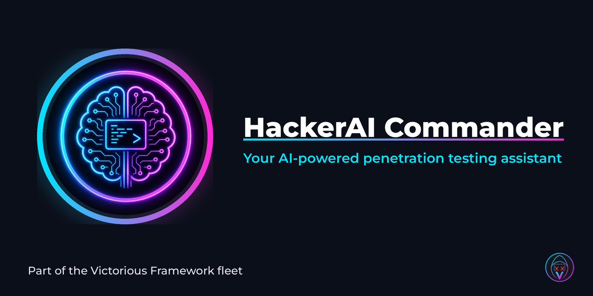

<div align="center">



# HackerAI Commander

**Your AI-powered penetration testing assistant.**

Works on its own; fleet integration (droidcommand-AI) is optional

<p>
  <a href="https://github.com/Victorious93/HackerAI-Commander/releases"></a>
  <a href="LICENSE"></a>
  <a href="https://github.com/Victorious93/HackerAI-Commander/actions/workflows/android.yml"></a>
  <a href="https://github.com/Victorious93/HackerAI-Commander/actions/workflows/test.yml"></a>
  <a href="https://victorious-framework.pages.dev"></a>
</p>

</div>

This repository (`Victorious93/HackerAI-Commander`) is a fork of
[`hackerai-tech/hackerai`](https://github.com/hackerai-tech/hackerai). It
contains two parts:

1. **The web app** — a TypeScript / Next.js + React application (the upstream
   HackerAI product). You run security workflows by chatting with an AI that
   can plan, use tools, and execute in isolated sandboxes.
2. **The Android companion APK** — a Kotlin / Jetpack Compose app under
   [`android/`](android/) (`applicationId` `ai.hackerai.companion`) that can
   run on-device tasks and, optionally, expose those capabilities to
   [DroidCommand AI](https://github.com/Victorious93/droidcommand-AI) over an
   AIDL bound service.

> **Defensive use only.** Point HackerAI (web or companion) only at systems you
> own or are explicitly authorized to test. You are responsible for staying
> within the law and your authorization scope.

## Features

- **Web app.** Chat with an AI to **find and fix vulnerabilities**. Agent mode
  can plan, use tools, and run in isolated sandboxes. You choose how actions
  are approved (ask first, approve only potentially unsafe actions, or full
  access).
- **Android companion.** On-device **Ask / Run task** with a saved API key;
  Settings (save/test a key without displaying it); a Status setup checklist;
  and an Approvals tab for confirm-gated tasks. In-app Help is included.
- **Optional fleet integration.** Binding to DroidCommand AI is opt-in.
  External control defaults **OFF** and is never turned on by a config import.
  Destructive remote operations still require on-device confirmation. The
  privileged Shizuku shell stays local-only.
- **Fleet theme (read-only).** When VictorLaunch publishes a fleet theme, the
  companion can apply it live. It never writes the theme provider.
- **Planned, not implemented:** a Notebook mode for source-grounded Q&A over
  the user's own uploaded documents. There is no Notebook feature in this
  codebase today.

## Screenshots

These are real shots of the **web app** agent auto-review UI, already in
`docs/screenshots/`. There are no Android companion screenshots in the
repository yet.

<p align="center">
  
  
</p>
<p align="center">
  
  
</p>

## Install / download

The published artifact is the **Android companion** APK from GitHub Releases.

- Latest release: [v0.2.0](https://github.com/Victorious93/HackerAI-Commander/releases/tag/v0.2.0)
- APK: [`hackerai-companion-v0.2.0.apk`](https://github.com/Victorious93/HackerAI-Commander/releases/download/v0.2.0/hackerai-companion-v0.2.0.apk)
  (`applicationId` `ai.hackerai.companion`, `versionName` 0.2.0,
  `versionCode` 200, about 1.8 MB). Signed with the shared fleet release key.
- All releases: <https://github.com/Victorious93/HackerAI-Commander/releases>

Install notes:

- Uninstall any **debug** build first. Android will not upgrade a
  debug-signed build in place with this release-signed APK.
- If you want the optional DroidCommand AI binding, install a **release**
  build of DroidCommand AI (`ai.droidcommand.app`) signed with the same fleet
  key, then install this APK.
- The web app is not shipped as a downloadable binary; build it from source
  (below).

## Build from source

Clone this repository:

```bash
git clone https://github.com/Victorious93/HackerAI-Commander.git
cd HackerAI-Commander
```

### Web app

The web app is the upstream `hackerai-tech/hackerai` product. You will need
accounts for the services it uses.

**Required:** [OpenRouter](https://openrouter.ai/),
[OpenAI](https://platform.openai.com/), [E2B](https://e2b.dev/),
[Convex](https://www.convex.dev/), [Amazon S3](https://aws.amazon.com/s3/),
[WorkOS](https://workos.com/), [Trigger.dev](https://trigger.dev/).

**Optional:** [abliteration.ai](https://abliteration.ai/),
[Perplexity](https://perplexity.ai/), [Jina AI](https://jina.ai/reader),
[Redis](https://redis.io/), [Upstash Redis](https://upstash.com/),
[PostHog](https://posthog.com/), [Stripe](https://stripe.com/).

```bash
pnpm install
pnpm run setup
pnpm run dev
```

`pnpm run dev` starts both the Next.js and Convex dev servers. You can also
run them separately (`pnpm run dev:next` and `pnpm run dev:convex`).

To use Agent mode locally, create a Trigger.dev project, put the **dev**
secret key in `.env.local` as `TRIGGER_SECRET_KEY`, add the worker
environment variables in the Trigger.dev dashboard (Convex, OpenRouter,
OpenAI, S3, and E2B keys, plus any optional keys you use), and start the
worker with `pnpm dev:trigger`. Do not commit those keys.

To use abliteration.ai for eligible security requests, set
`ABLITERATION_API_KEY` in `.env.local`, Vercel, and Trigger.dev. Without
that optional key, HackerAI continues using its standard models.

Useful scripts from [`package.json`](package.json):

| Script | What it does |
| --- | --- |
| `pnpm dev` | Run Next.js (`next dev --turbopack`) and Convex together |
| `pnpm dev:next` / `pnpm dev:convex` | Run each dev server on its own |
| `pnpm dev:trigger` | Start the Trigger.dev worker |
| `pnpm build` | `next build` (plus PostHog sourcemap upload) |
| `pnpm start` | `next start` (serve the production build) |
| `pnpm lint` | ESLint over `app lib types __mocks__` |
| `pnpm typecheck` | `tsc --noEmit` |
| `pnpm test` / `pnpm test:ci` | Jest unit tests (CI variant adds coverage + skills check) |
| `pnpm test:e2e` | Playwright end-to-end tests |
| `pnpm format` / `pnpm format:check` | Prettier write / check |

Web-app CI is [`.github/workflows/test.yml`](.github/workflows/test.yml)
(workflow name: **Run Tests**).

### Android companion

Toolchain, verified from the repo:

- **JDK 17** (`sourceCompatibility` / `targetCompatibility = VERSION_17`,
  `jvmTarget = "17"`).
- **Gradle 8.13** via the committed wrapper (`android/gradlew`,
  `android/gradle/wrapper/gradle-wrapper.properties`).
- **Android Gradle Plugin 8.7.3**, **Kotlin 2.1.0**
  (`android/gradle/libs.versions.toml`).
- `compileSdk` / `targetSdk` **35**, `minSdk` **26**, `applicationId`
  `ai.hackerai.companion`.

```bash
cd android
./gradlew assembleDebug
# output: android/app/build/outputs/apk/debug/app-debug.apk
```

Other common tasks:

```bash
./gradlew :app:assembleRelease   # unsigned unless release signing env vars are set
./gradlew :app:signingReport     # show the resolved signing configs
./gradlew test                   # JVM unit tests
```

The `ai.droidcommand.hackerai` sources under
`android/app/src/main/kotlin/ai/droidcommand/hackerai/` are **vendored** from
the droidcommand-AI `core-hackerai` module; see
[`VENDORED.md`](android/app/src/main/kotlin/ai/droidcommand/hackerai/VENDORED.md).

**Debug signing.** Debug builds use a dedicated, stable debug keystore
committed at
[`android/keystore/hackeraietc-debug.keystore`](android/keystore/hackeraietc-debug.keystore).
That keeps the debug signer stable so a newer debug build installs over an
older one. It is not a release key; release keys are never committed.

**Release signing.** Release builds are signed with the shared fleet release
key, which exists only in CI secrets and is never committed. The release
`signingConfig` in [`android/app/build.gradle.kts`](android/app/build.gradle.kts)
reads `ANDROID_RELEASE_KEYSTORE_B64`, `ANDROID_RELEASE_STORE_PASSWORD`,
`ANDROID_RELEASE_KEY_ALIAS`, and `ANDROID_RELEASE_KEY_PASSWORD` from the
environment. If any are absent (local builds, PRs, forks), the build produces
an **unsigned** release instead of failing. Secret values are never printed
here.

CI verifies the release signer against the non-secret repository variable
`ANDROID_RELEASE_CERT_SHA256`
(`9E:A7:B3:14:94:5B:0A:62:97:15:6F:F7:06:E7:0C:0A:B1:B7:24:DE:06:D5:09:9C:A5:12:8A:B4:43:F7:2D:8D`).

Android CI is [`.github/workflows/android.yml`](.github/workflows/android.yml)
(workflow name: **Android CI**): on push/PR touching `android/**` it builds
`assembleDebug`, verifies the debug signer, and uploads the debug APK as an
artifact. The tag-triggered
[`.github/workflows/android-release.yml`](.github/workflows/android-release.yml)
(**Android Release**) builds `assembleRelease` on `v*` tags, verifies the
release signer, and attaches the signed APK to a **draft** GitHub release for
a human to review and publish.

Releases are cut by pushing a `vMAJOR.MINOR.PATCH` tag. Versioning is derived
from the tag: `versionName` = `MAJOR.MINOR.PATCH`,
`versionCode` = `MAJOR*10000 + MINOR*100 + PATCH`. Local and non-tag builds
fall back to `versionName 0.1.0` / `versionCode 1`.

## Manual

How-to for the Android companion: [docs/MANUAL.md](docs/MANUAL.md).

Coding agents should start with [AGENTS.md](AGENTS.md), which covers the
fleet relationship, the AIDL contract, and the security model in more detail.

## License

Licensed under the **Apache License 2.0 with Commercial Restrictions** — see
[LICENSE](LICENSE) for the full terms, including
`Copyright (c) 2025 HackerAI, LLC`. Third-party notices are in
[THIRD_PARTY_NOTICES.md](THIRD_PARTY_NOTICES.md).

## Credits

This repository is a Victorious Framework fork of
[`hackerai-tech/hackerai`](https://github.com/hackerai-tech/hackerai).
Credit for the web product and its design belongs to HackerAI, LLC.
Upstream license: Apache License 2.0 with Commercial Restrictions — see
[LICENSE](LICENSE). Upstream trademarks and product names remain their
owners'.
